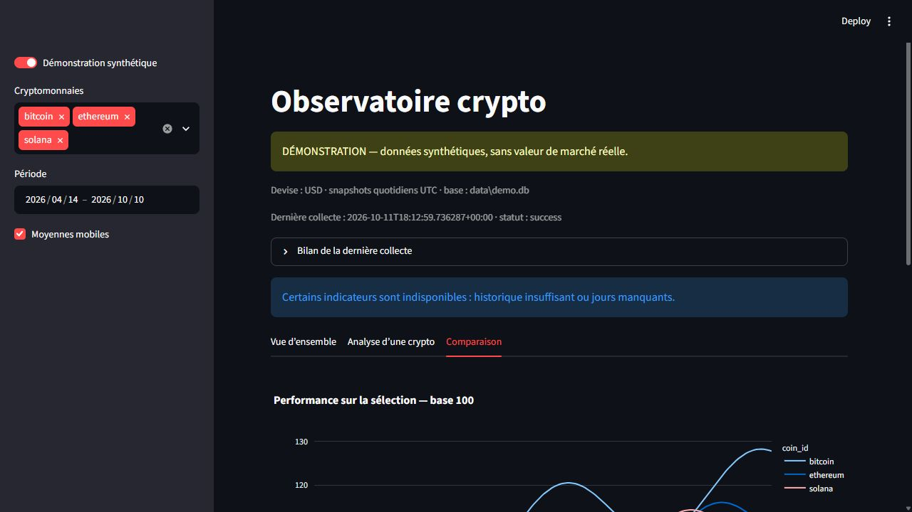

# Observatoire crypto — ETL Python local

Bitcoin, Ethereum et Solana : API CoinGecko → pandas → SQLite → indicateurs → Streamlit/Plotly.
Le dashboard lit exclusivement SQLite. Une collecte manuelle fusionne les 180 derniers jours.
Le projet est destiné à l'analyse descriptive et à la présentation d'une chaîne de données.

## Installation (Python 3.10 ou supérieur)

Depuis le dossier du projet, sous Windows PowerShell :

```powershell
python -m venv .venv
.venv\Scripts\Activate.ps1
python -m pip install -e ".[dev]"
crypto-etl demo
streamlit run dashboard/app.py
```

Sous Linux : remplacer l'activation par `source .venv/bin/activate`.
Le téléchargement des dépendances nécessite Internet. Les tests et la démonstration n'en ont pas besoin.
Le dashboard démarre en mode **démonstration synthétique**, explicitement signalé.
Ses valeurs sont déterministes et fabriquées ; elles ne représentent pas des cours réels.
La base `data/demo.db` et les archives `data/raw-demo/` sont distinctes des données réelles.



Validation locale : 18 tests réussis, Ruff et formatage validés ; démonstration chargée
avec 540 observations (180 jours × 3 actifs). Les interactions ont aussi été vérifiées
dans le navigateur. Aucune collecte réelle effectuée sans clé API.

## Collecte réelle et configuration

Créer une clé Demo depuis [CoinGecko](https://www.coingecko.com/en/api).
Ne jamais mettre la clé dans le code, une URL ou un commit.

```powershell
$env:COINGECKO_API_KEY="votre_cle"
$env:CRYPTO_CURRENCY="usd"
$env:CRYPTO_DAYS="180"
crypto-etl update
streamlit run dashboard/app.py
```

Linux : `export COINGECKO_API_KEY='votre_cle'`, puis les mêmes commandes.
Dans le dashboard, désactiver « Démonstration synthétique » pour lire `data/market.db`.
`.env.example` décrit les variables ; aucun fichier `.env` n'est chargé automatiquement.
`CRYPTO_DATA_DIR` configure le dossier local (par défaut `data`, relatif au dossier d'exécution).
Toujours exécuter les commandes depuis le même dossier ou définir un chemin absolu.

## Données et garanties

`GET /coins/{id}/market_chart`, paramètres `vs_currency`, `days`, `interval=daily` ;
clé dans `x-cg-demo-api-key`, timeout 30 s, quatre tentatives au maximum sur erreur réseau,
429 ou serveur. `Retry-After` numérique ou date HTTP est respecté ; sinon délai exponentiel.
Les erreurs de requête/authentification sont immédiates. Les messages externes ne sont pas
recopiés dans les logs afin d'éviter de divulguer une clé.

Chaque réponse JSON décodable est archivée avant transformation dans un dossier identifié
par l'exécution. Une réponse illisible ne peut pas être archivée comme JSON.
Pour rejouer une archive : charger le fichier avec `json.loads`, appeler `transform(payload,
coin, currency, days, now=...)` avec la date UTC de collecte d'origine, puis `upsert`.

Les trois séries sont jointes par timestamp exact, jamais par position. À timestamp dupliqué,
la dernière occurrence de chaque série gagne. Pour chaque jour, le dernier snapshot ayant un
prix valide est conservé, sans reprendre le volume d'un autre timestamp. Le jour UTC courant
et les dates futures sont exclus. La fenêtre conservée couvre les `days` jours terminés.
Prix non fini, nul ou négatif : rejet. Volume/capitalisation invalide : SQL NULL signalé.
Aucune interpolation. Les jours manquants, valeurs manquantes et variations absolues > 50 %
sont comptabilisés ; une forte variation reste dans la base.

La clé primaire `(coin_id, vs_currency, date_utc)` permet un upsert transactionnel par crypto.
Relancer une collecte ne duplique pas les lignes et corrige les prix révisés. Une crypto en
échec conserve ses données précédentes ; `pipeline_runs` indique success, partial ou failed.
Une interruption brutale peut laisser un run « running » : vérifier les logs puis relancer.
Les anciennes lignes hors fenêtre ne sont pas supprimées : l'historique local s'enrichit.

CoinGecko fournit des observations agrégées, pas une clôture officielle de marché.
Le volume sur 24 h est un snapshot et ne doit pas être additionné entre observations.
L'offre Demo limite l'historique accessible à 365 jours (documentation vérifiée le 11/10/2026).
Sources : [historique](https://www.coingecko.com/learn/download-bitcoin-historical-data),
[authentification](https://support.coingecko.com/hc/en-us/articles/4538879945625-API-key-can-I-store-the-key-in-my-headers),
[snapshots et OHLC](https://support.coingecko.com/hc/en-us/articles/23126953719321-Why-is-there-a-discrepancy-between-the-close-price-of-a-token-on-the-coins-id-market-chart-interval-daily-endpoint-and-the-OHLC-prices-for-the-same-token).

## Indicateurs

Chaque crypto/devise utilise un calendrier quotidien explicite, avec trous conservés.

| Mesure | Formule / règle |
|---|---|
| Variation 1 jour (%) | `100 × (P(t)/P(t−1)−1)` |
| Variation 7 jours (%) | `100 × (P(t)/P(t−7)−1)`, date exacte |
| Moyennes 7/30 jours | moyenne, fenêtre complète sans prix manquant |
| Volatilité 30 jours (%) | écart-type des 30 rendements 1 jour en %, `ddof=1`, non annualisé |
| Base 100 | `100 × P / premier prix disponible de la sélection` |
| Performance sélection (%) | `base_100 final − 100` |
| Drawdown (%) | `100 × (P / maximum cumulé de la sélection − 1)` |

Les indicateurs historiques sont calculés avant le filtre de dates ; base 100 et drawdown
sont recalculés après filtrage. Les résultats indisponibles restent nuls. La volatilité
nécessite 31 prix consécutifs. Le tableau indique la date du dernier prix de chaque actif ;
si leurs dates diffèrent, les performances couvrent des observations différentes.

## Vérification

```text
ruff check .
ruff format --check .
pytest
crypto-etl demo
```

Les tests injectent des réponses HTTP simulées et utilisent des bases temporaires ; aucune
clé ni réseau. La CI GitHub Actions vérifie Python 3.10/3.12 sous Windows/Linux ; elle ne
collecte aucune donnée. Voir [le parcours pédagogique](docs/developpement.md) et
[la procédure de planification](docs/planification.md).

## Git et publication

Le dépôt est initialisé localement. `git add` prépare les fichiers, `git commit` crée un
jalon ; `git status` vérifie les modifications et `git log --oneline` montre les étapes.
L'identité d'auteur est passée aux commits avec `git -c user.name=... -c user.email=...` ;
aucune configuration globale n'est modifiée. `.gitignore` exclut clés, données, bases,
logs et environnement virtuel. **Aucun dépôt distant créé et aucun push effectué.**
Après accord explicite seulement : créer un dépôt GitHub vide, puis `git remote add origin
URL_DU_DEPOT` et `git push -u origin master`. Vérifier auparavant `git diff --cached`,
`git ls-files`, et l'absence de secret dans l'historique. Le README et la CI sont prêts.
